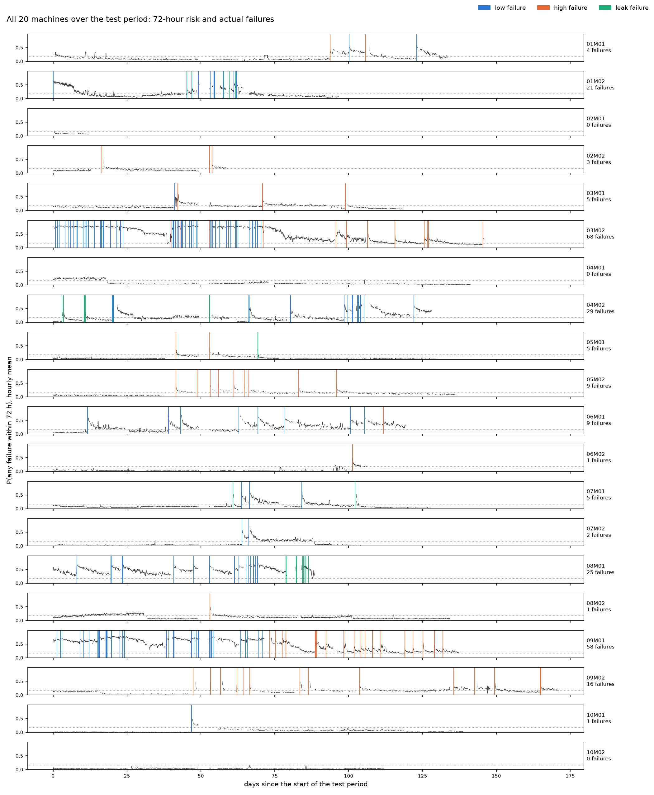
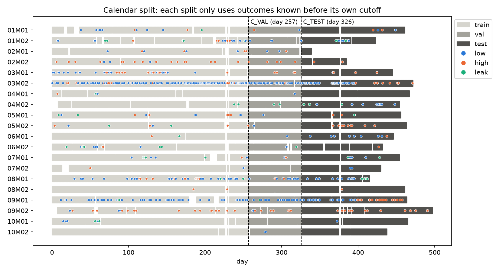

# 半導體設備的動態故障風險預測（PHM 2018）

> Dynamic next-failure prediction using a competing-risk formulation on longitudinal semiconductor equipment data.

**問題：能不能用半導體設備的 longitudinal sensor 資料與故障歷史，動態預測未來的故障風險與故障類型？**

## 重點

- **資料**：20 台離子蝕刻機台，約一年的資料，共 82M 筆 sensor 紀錄與 1,211 筆故障（3 種類型）
- **方法**：設計不偷看未來的 longitudinal 預測樣本（日曆切分、episode 定義、自動洩漏檢查），並比較 Snapshot DeepHit 與 Dynamic-DeepHit（LSTM + temporal attention）
- **結果**：Dynamic-DeepHit（L = 64）在三種故障上的 C-index 都高於 snapshot，洩漏從 0.567 提升到 0.667。72 小時預警時，近 7 天有出過事的故障，故障前的風險中位數為 **0.63**，平靜時段只有 **0.09**
- **應用**：可用於辨識近期故障後仍處於高風險的設備與時段；近 7 天沒出過事的故障，提前辨識能力有限。

**技術**：Python · PyTorch · pandas · Survival Analysis（Competing Risks）· Time-series Feature Engineering



## 主要發現

**故障風險可以動態預測，但風險主要由故障群聚驅動，而不是 sensor 的漸進劣化，因此這個模型最適合用來提醒「哪幾台機台正在密集出事」。**

1. **建立了不偷看未來的 longitudinal 預測流程**：先把不規則的 4 秒資料轉成 5 分鐘窗。事故、episode、預測範圍的定義都以 EDA 為依據，切分、標籤、特徵、標準化也只使用當下已知的資訊，並經過自動檢查。
2. **動態模型的排序能力全面提升**：Dynamic-DeepHit（L = 64）的 C-index 在三種故障上都高於 snapshot（+0.02～+0.10），洩漏提升最多（0.567 → 0.667）。機率準確度（IPA@24h）則看故障類型：壓力過低明顯提升（0.177 → 0.245），壓力過高反而下降（0.054 → 0.031）。
3. **找出故障風險的主要來源：故障群聚**：
   - 在輸入相同（最新一個窗 + 事故歷史）的情況下，只把模型換成 Dynamic-DeepHit（L = 1），壓力過低的 IPA 就從 0.177 提升到 0.240，洩漏的 C-index 從 0.567 提升到 0.664。
   - 再加入約 7 小時的 sensor 歷史（L = 1 → 64），主要提升壓力過高的排序（C-index +0.031），其他指標的變化都在 0.01 以內。
   - 故障發生後，風險會立刻跳高，之後在 episode 內逐漸下降。模型學到的是「哪台機台、哪個時段危險」，這也呼應資料中「剛恢復生產時最容易再出事」的現象。
4. **72 小時風險預測能辨識接連發生故障的高風險時段**：同一台機台近 7 天有出過事時，故障前 72 小時的風險中位數為 0.63；近 7 天沒出過事的故障只有 0.13，跟平靜時段的 0.09 差不多（見[第 5 節](#5-預警實際能做到什麼interpretation)）。
5. **故障類型辨識**：整體命中率 78%，略低於「沿用前一次事故類型」的 83%。模型偏向猜壓力過低（命中 98%），洩漏從未被排在第一，是主要的改進方向（見[限制](#限制)）。

## 資料與任務

- **資料**：[PHM Data Challenge 2018](https://www.phmsociety.org/events/conference/phm/18/data-challenge)。20 台離子蝕刻機台，每 4 秒一筆 sensor 資料，共 82M 筆、約一年。另有 1,211 筆故障紀錄，分成 3 種類型：Flowcool 壓力過低、壓力過高、洩漏。
- **任務**：在任何時間點 t，只用 t 以前的資料，預測接下來 7 天內是否會發生故障，以及是哪一種故障。

## 流程

```
原始 sensor CSV（每 4 秒，82M 筆）
   ↓  看資料 → 定義事故、episode、輸入形式                     data_prep/01_eda
   ↓  每 5 分鐘聚合 → 時間切分 → 標籤 → 事故歷史 → 洩漏檢查      data_prep/02_build_dataset
5 分鐘時間窗（1.3M 個 × 52 個 sensor 特徵）+ 10 個事故歷史特徵
   ↓  標準化（只用 train）→ snapshot DeepHit vs Dynamic-DeepHit   training/training
未來 7 天三種故障各自的風險（competing risks）
   ↓  讀取存下的模型：單一預測、20 台機台的 72 小時風險           training/interpretation
```

| Notebook | 回答的問題 |
|---|---|
| [01_eda](data_prep/01_eda.ipynb) | 原始資料長怎樣？event 和 episode 要怎麼定義？輸入應該怎麼設計？ |
| [02_build_dataset](data_prep/02_build_dataset.ipynb) | 怎麼把 sensor stream 變成不偷看未來的訓練樣本？ |
| [training](training/training.ipynb) | 動態模型比只看「現在」的模型好多少？能不能做 early warning？ |
| [interpretation](training/interpretation.ipynb) | 給定一台機台和一個時間點，模型說了什麼？部署到 20 台機台上會看到什麼？ |

## 1. 時間序列處理：從資料特性決定設計（01）

| 觀察到的現象 | 對應的設計 |
|---|---|
| 每 4 秒一筆，但只在加工時記錄（19%～56% 的時間） | 聚合成 5 分鐘窗，把不規則的資料變成近乎等距的序列，並加上「與上一個窗的間隔」 |
| sensor 隨 recipe step 切換，大約 15 分鐘一個循環 | 每個窗內取 mean／std／min／max |
| 14% 的故障和前一筆故障之間，機台沒有恢復生產 | 兩者合併成同一次事故；一個 episode 定義為從恢復生產到下一次事故 |
| 82% 有事故的 episode 在 7 天內結束 | 預測範圍定為 7 天，超過就截尾 |
| 前一次事故的類型對下一次有很強的預測力（壓力過低之後，83% 仍是壓力過低） | 把事故歷史當成輸入 |
| 故障前 24 小時看不到 sensor 逐漸漂移，只有最後 2～3 小時有小幅變化 | 比較不同的歷史長度：L = 1／12／64 個窗 |

## 2. 建立不偷看未來的 longitudinal 樣本（02）

同一台機台會被重複觀測，故障也會一再發生，而且每 5 分鐘就是一個預測時間點。相鄰兩個預測時間點的輸入歷史幾乎完全重疊（64 個窗中有 63 個相同），也指向同一次故障。如果隨機切分，test 樣本在 train 裡幾乎都會有「雙胞胎」，造成資料洩漏。因此做了以下設計：

- **日曆截止日切分**：所有機台共用同一組截止日，切成 train／val／test，和實際部署的情境一致：用同一批機台的過去，預測它們的未來。
- **每個 split 只使用截止日以前已知的結果**：在 train 期間還沒出事的 episode，於截止日截尾。
- **時間窗不跨越故障**：先把每筆資料指派到所屬的 episode，再做聚合。
- **標準化只用 train**：平均數與標準差只用 train 計算，再套用到 val／test。
- **輸入只用 t 以前的資訊**：模型的輸入序列只包含 t 以前（含 t）的窗，每個窗的事故歷史也只用該窗當時的值。



## 3. 模型

- **Snapshot DeepHit**（baseline）：輸入事故歷史和最新一個 5 分鐘窗，經過 MLP 後，每種故障各接一個 head。
- **Dynamic-DeepHit**（Lee et al., 2020）：參照[官方實作](https://github.com/chl8856/Dynamic-DeepHit)的結構，用 PyTorch 重新實作。以 LSTM 讀取過去的時間窗，用 temporal attention 整合歷史資訊，輸出三種故障在未來 0～168 小時的累積發生率。

<details>
<summary>架構、與論文的差異、超參數</summary>

```
x_j = [第 j 個窗的 sensor 特徵, 第 j 個窗當時的事故歷史]
x_1 ... x_{M-1} → 2 層 LSTM → h_1 ... h_{M-1}          （最新的窗 x_M 不進 RNN）
temporal attention：e_j = FCNet([h_j, x_M]) → context = Σ a_j h_j
[x_M, context] → 共享 FC → 每種故障一個 FCNet → 一個 softmax（3 種故障 × 16 格 + 「撐過 168 小時」1 格）
loss = NLL + 0.1 × ranking + γ × RNN 預測（h_j 預測下一個窗）+ L1
```

**依任務調整的地方**
- 時間軸從預測時間點 t 起算（0～168 小時），每個預測時間點產生一筆樣本。
- softmax 多一格「撐過 168 小時」，用來放超過預測範圍的截尾樣本。
- ranking loss 對 batch 取平均，RNN 預測 loss 對有效步數取平均，讓不同 L 的訓練目標一致。
- 不使用 missing indicator，因為 5 分鐘窗沒有缺值。

**超參數在 validation 上選擇**
以 L = 64 為準，用 val NLL 選擇，同時檢查 val C-index 和 IPA@24h。搜尋範圍：網路大小 {32, 100}² × lr {1e-3, 1e-4} × dropout {0.1, 0.3}，再選 γ ∈ {0, 0.1, 1}。最後選定 RNN hidden 32、FC hidden 100、lr 1e-4、dropout 0.1、γ = 1。L = 1／12／64 使用同一組超參數。

</details>

## 4. 結果與 early warning（training）

Test 期間為第 326 天之後，共 262 次事故（壓力過低 163 次、壓力過高 70 次、洩漏 29 次）。

| 故障 | 模型 | C-index（排序） | IPA@24h（機率準確度） |
|---|---|---|---|
| 壓力過低 | Snapshot DeepHit | 0.790 | 0.177 |
| | Dynamic-DeepHit, L = 1 | **0.817** | 0.240 |
| | **Dynamic-DeepHit, L = 64**（約 7 小時歷史） | 0.815 | **0.245** |
| 壓力過高 | Snapshot DeepHit | 0.820 | **0.054** |
| | Dynamic-DeepHit, L = 1 | 0.804 | 0.029 |
| | **Dynamic-DeepHit, L = 64** | **0.835** | 0.031 |
| 洩漏 | Snapshot DeepHit | 0.567 | −0.016 |
| | Dynamic-DeepHit, L = 1 | 0.664 | 0.018 |
| | **Dynamic-DeepHit, L = 64** | **0.667** | **0.024** |

- C-index 0.5 等於隨機。IPA > 0 表示比「每個時間點都給 train 的平均風險」更準。
- 加入約 7 小時的 sensor 歷史（L = 1 → 64）後，壓力過高的排序提升最多（C-index +0.031）。L = 12 的結果與 L = 64 相近（差距約 0.01 以內），詳見 notebook。

## 5. 預警實際能做到什麼（interpretation）

[interpretation](training/interpretation.ipynb) 讀取 training 存下的 Dynamic-DeepHit（L = 64）權重，回到模型的實際輸出來檢視。每個預測都是條件機率：在 episode 撐到 t 還沒出事、且已知 t 以前所有資料的前提下，接下來 72 小時內發生第 k 種故障的機率。選擇 72 小時，是為了保留 3 天的時間準備維修。模型一次輸出 0～168 小時的完整累積發生率，要改用其他預警範圍也不需要重新訓練。

**全部預測時間點，依 72 小時內的實際結果分組**

| 72 小時內實際結果 | 時間點數 | P(任何故障) | 類型命中：模型 | 類型命中：沿用前一次類型 |
|---|---|---|---|---|
| 壓力過低 | 2,351 | 0.47 | 98% | 86% |
| 壓力過高 | 1,350 | 0.26 | 66% | 86% |
| 洩漏 | 398 | 0.23 | 0% | 51% |
| 沒出事 | 21,491 | 0.14 | — | — |

- **是否會出事**：會出事的時間點，預測風險為 0.23～0.47；沒出事的時間點是 0.14，兩者明顯分開。
- **但能預警的主要是接連發生的故障**：同一台機台近 7 天有出過事的故障（208 次），故障前 72 小時的風險中位數為 0.63，其中 85% 超過 0.3；近 7 天沒出過事的故障（48 次）只有 0.13，跟平靜時段（離下一次故障 > 72 小時）的 0.09 差不多。
- **能區分不同機台的風險**：各機台的平均預測風險和實際故障次數高度一致（Spearman 0.86）。
- **風險呈鋸齒狀**：故障後風險立刻升高，之後逐漸下降，反映出故障群聚的特性。模型在回應「剛出過事」，不是在故障前提早升高（見開頭的圖）。
- **故障類型**：模型傾向預測壓力過低，所以壓力過低的命中率很高，但洩漏從未被排在第一。

<details>
<summary>各預警範圍的表現</summary>

**不同預警範圍 τ（val／test）**

| τ | AUC 任何故障 | IPA 壓力過低 | IPA 壓力過高 | IPA 洩漏 |
|---|---|---|---|---|
| 6 小時 | 0.849／0.856 | 0.100／0.099 | −0.006／0.008 | −0.007／0.017 |
| 24 小時 | 0.852／0.841 | 0.261／0.245 | 0.002／0.031 | −0.012／0.024 |
| **72 小時** | 0.813／0.801 | 0.357／0.264 | 0.011／0.116 | −0.008／0.013 |
| 168 小時 | 0.765／0.787 | 0.282／0.237 | 0.034／0.189 | −0.002／0.015 |

- 任何故障的 AUC 在所有範圍都維持在 0.77～0.86。

**解讀一筆預測的三個層次**：72 小時內出事的機率 → 三種故障各自的絕對機率 → 如果出事，最可能是哪一種。

</details>

## 限制

- 只有約 4 成的故障發生在加工中，很多故障發生前一刻沒有 sensor 資料，限制了 sensor 訊號能提供的預警資訊。
- 近 7 天沒出過事的故障，預警效果有限，主要能預警的是接連發生的故障。
- test 是同一批 20 台機台的後段時間，沒有驗證過模型用在全新機台上的表現。
- 指標是對每個預測時間點取平均。撐超過 7 天的 episode 只佔 19%，卻貢獻了 86% 的預測時間點，因此指標主要反映平靜期的區分能力。
- 壓力過高與洩漏的 24 小時機率準確度接近平均風險（IPA ≈ 0.02～0.03）。洩漏類型的辨識是最主要的改進方向。

## 環境與執行

```bash
conda env create -f environment.yml   # Python 3.11，套件版本見 environment.yml
conda activate phm2018
```

1. 從 [PHM Data Challenge 2018](https://www.phmsociety.org/events/conference/phm/18/data-challenge) 下載原始資料，放到 `data/raw/phm_data_challenge_2018/`
2. 依序執行 `data_prep/01_eda.ipynb` → `data_prep/02_build_dataset.ipynb` → `training/training.ipynb` → `training/interpretation.ipynb`

<details>
<summary>專案結構</summary>

```
data_prep/
  01_eda.ipynb             原始資料 → event／episode 定義 → 輸入設計（含 CSV → parquet 轉檔）
  02_build_dataset.ipynb   時間窗、時間切分、標籤、事故歷史、洩漏檢查
  figures/
    01_eda/                EDA 的圖、table1.csv
    02_build_dataset/      split_timeline.png
training/
  training.ipynb           標準化、snapshot DeepHit vs Dynamic-DeepHit（L = 1／12／64）
  interpretation.ipynb     讀取存下的模型：預警範圍、單一預測、20 台機台、各結果下的預測
results/
  <日期時間>/               每次執行 training 的結果：metrics.csv、hparams.json、每個 epoch 的 log、
                           loss_curves.png、模型權重
    interpretation/        由這次模型產生的結果：by_horizon.csv、one_prediction.png、
                           fleet_72h.png、fleet_hourly_72h.csv、by_outcome_72h.csv
  20261011_145955/         README 引用的這次結果（含 interpretation/）
data/                      不進 git：raw/（原始 CSV）、processed/（notebook 產出）
```

</details>

## 參考資料

- PHM Society. [PHM Data Challenge 2018](https://www.phmsociety.org/events/conference/phm/18/data-challenge).
- Lee, C., Yoon, J., & van der Schaar, M. (2020). Dynamic-DeepHit: A Deep Learning Approach for Dynamic Survival Analysis With Competing Risks Based on Longitudinal Data. *IEEE Transactions on Biomedical Engineering*, 67(1), 122–133. https://doi.org/10.1109/TBME.2019.2909027 ｜ [官方實作](https://github.com/chl8856/Dynamic-DeepHit)
